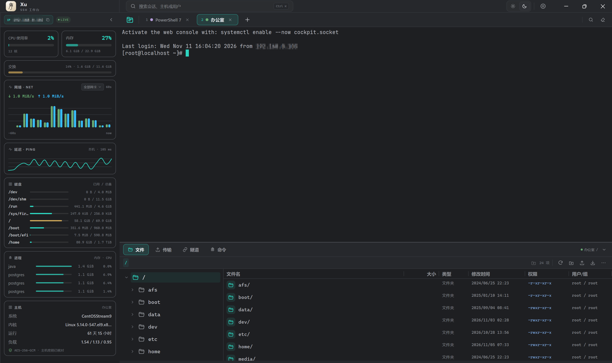
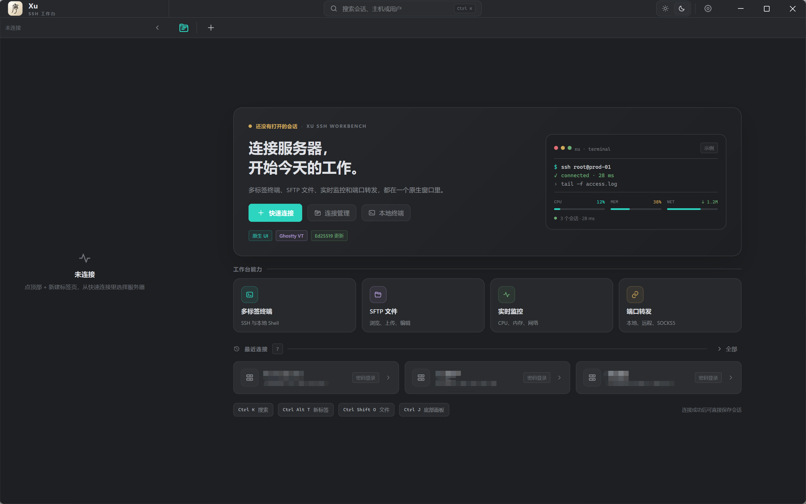

# Xu

> 一个原生跨平台 SSH 工作台：多标签终端、SFTP 文件管理、实时服务器监控、端口转发与批量命令，不使用 WebView。





- 版本：`0.3.8`
- 技术栈：Go `1.27.4` + [mygo](https://github.com/egoist/mygo) `0.10.0` 原生 UI + Ghostty VT
- 平台：Windows（x64）、macOS（Universal）、Linux（amd64 / arm64）
- 项目主页：<https://wlj521.github.io/xu/>

> **Windows 打包：**
>
> ```powershell
> .\build-local.ps1
> ```
>
> **macOS / Linux 打包：** 使用下方 `go tool mygo build -platform ...`。

---

## 功能

- **会话管理**：用户自建分组、保存 SSH 连接、密码/私钥/SSH Agent/MFA 认证、主机密钥 TOFU 校验、快速连接与连接管理器；支持从 JSON 连接配置批量导入服务器；同一服务器可开多个标签页（自动编号区分）。
- **SSH 密钥**：连接配置可选择任意私钥文件或生成新的 Ed25519 密钥（可先填写口令生成加密私钥）；加密私钥在连接时于应用内询问口令，可查看公钥 SHA256 指纹并复制公钥。支持 keyboard-interactive / MFA 多轮认证，服务器要求的验证码或动态口令会在应用内弹窗输入。
- **工作区恢复**：最近连接按实际成功连接时间排序；退出后再次启动时会按原标签顺序恢复已保存服务器，并自动启动设置为自动的端口转发。遇到 MFA、私钥口令或首次主机指纹时会暂停自动连接，等待用户确认后继续。
- **备份与迁移**：连接管理器或「设置 → 连接 → 备份与迁移」可导出 Xu JSON 备份，包含连接、分组、快捷命令、端口转发和常规设置，不包含密码、私钥内容或 known_hosts；支持导入 Xu 备份和标准 OpenSSH `config`，冲突可选择跳过、覆盖或重命名。
- **主机密钥**：「设置 → 连接 → 主机密钥」可查看已保存的主机地址与完整 SHA256 指纹，并删除不再信任的记录；主机重装导致指纹变化时，连接前的确认弹窗会同时显示旧值和新值，明确提示风险后再更新。
- **跳板机**：连接配置可选择另一个已保存连接作为跳板机，并通过它打开 SSH 隧道；跳板机自身也可继续选择跳板机，形成多级链路，循环引用会被阻止。
- **终端**：多标签页 SSH 终端与本地终端（顶部标签栏切换/关闭，同一服务器可开多个标签）、查找、清屏、断线重连。
- **快捷命令**：顶部查找按钮左侧提供快捷命令菜单，支持全局和当前服务器两种作用范围；可新增、编辑、删除常用命令，点击命令只填入当前终端，确认无误后按 Enter 执行，适合快速进入项目目录或查看日志。
- **日志高亮**：内置通用日志、Nginx、JSON 三套规则包，自动给时间戳、TRACE/DEBUG/INFO/WARN/ERROR、线程、logger、IP、HTTP 方法等字段着色；支持自定义正则/关键字、16 色调色板、整行/加粗和排序，也可以添加多条自定义日志格式（从行首匹配的正则）来识别特殊日志行。修改即时作用于已打开的 SSH 终端的新输出；含 ANSI 颜色、进度条和全屏程序的行原样放行（本地终端暂不支持）。详见 [日志高亮使用说明](docs/log-highlight.md)。
- **文件**：底部文件面板：左侧目录树、面包屑路径，文件名 / 大小 / 类型 / 修改时间 / 权限 / 用户组列表；SSH 会话浏览远端 SFTP，本地终端不显示底部文件面板；远端默认从 `/` 打开，单击选中、双击目录进入下一层，面板高度可上下拖动（双击分隔条复位），支持上传、文件/文件夹下载、新建文件/文件夹、重命名、删除（文件夹连同其中的内容一起删除，可随时停止）、远程文本编辑；编辑器以浮动多标签窗口显示在终端区域上方，底部文件面板保持可用，可继续双击文件同时编辑多个文件；可以直接把本机文件和文件夹拖入远端目录上传，文件夹会保留原有层级，适合发布 `dist` 之类的构建产物。
- **传输队列**：上传和下载会进入并发队列，可在「传输」面板查看、暂停、继续或移除任务；每条任务和历史都会显示所属服务器，多个服务器同时传输时仍可区分。支持目录递归下载、失败重试、已完成文件续传、未完成文件按字节续传，以及覆盖 / 跳过 / 重命名三种同名文件策略。已保存服务器的等待、暂停和失败任务会跨重启保留，连接对应服务器后可继续，并复用 `.part` / `.xu-part` 文件；传输历史与任务状态分开保存，历史仍只保留最近 7 天。
- **监控**：左侧常驻服务器监控：CPU、内存、交换、网络上下行柱状图（可按网卡筛选）、延迟曲线、磁盘挂载点、进程内存/CPU 与主机信息；顶部显示服务器 IP，点击复制；可收起到侧边。
- **隧道**：本地转发、远程转发、SOCKS5。
- **批量命令**：在多台已保存主机上执行同一条命令。
- **界面**：深浅色主题、八种强调色（默认薄荷绿）、617 套内置 Ghostty 终端配色、顶部多标签会话、可收起左侧监控栏/底部面板；主机密钥确认、文件重命名和删除确认都使用应用内弹窗。
- **设置**：主题、强调色、终端配色、终端字号/字体/回滚缓冲、复制与查找行为、断线重连、工作区恢复、连接备份迁移、传输并发/同名策略、日志高亮规则；关闭设置时自动保存。
- **终端配色**：「设置 → 配色」可搜索、预览并即时应用 Ghostty/iTerm2 的 617 套配色；也支持把 Ghostty 主题文件（文件名即配色名）放进 `%LOCALAPPDATA%\ghostty\themes`，点「重新加载」后出现在列表中。
- **更新**：从 v0.1.1 起支持自动更新——启动后每天检查一次，也可在「设置 → 关于」手动检查；更新包使用 Ed25519 签名校验，下载后提示安装并重启。

界面布局：

```text
┌──────────────────────────────────────────────────────────────┐
│ 品牌 / 全局搜索                       主题  设置  窗口控制   │
├──────────────┬───────────────────────────────────────────────┤
│ 服务器监控    │ 标签栏：[1 PowerShell] [2 测试] [3 快速连接] +│
│              ├───────────────────────────────────────────────┤
│ IP / CPU     │ 终端 / 浮动多标签编辑器 / 快速连接            │
│ 内存 / 交换   │                                               │
│ 网络 / 延迟   │                                               │
│ 磁盘 / 进程   ├───────────────────────────────────────────────┤
│ 主机信息      │ 文件 │ 传输 │ 隧道 │ 命令                      │
└──────────────┴───────────────────────────────────────────────┘
```

- 顶部标签栏左侧的文件夹按钮打开**连接管理器**，`+` 打开**快速连接**新标签页：页内列出已保存的服务器，点卡片立即新开一个「连接中」标签页，标签内以终端样式显示 TCP、加密协商、认证、打开终端等真实阶段与耗时；连接成功后该标签原地变成终端，快速连接页自动关闭。关闭「连接中」标签页可取消连接。
- 快速连接与连接管理器都支持搜索、分组、编辑/删除连接；连接失败时快速连接页保留，标签内直接显示错误，可重试或编辑连接。
- 连接管理器支持批量导入 JSON 连接配置：可一次选择多个导出文件，自动跳过重复项和非 SSH 连接；能解析的密码会写入系统凭据存储。

## 环境要求

- Windows 10 1809+ / Windows 11（x64）
- macOS 12+（Intel / Apple Silicon）
- Linux（amd64 / arm64）
- Go `1.27.4`
- Windows 打包需要 PowerShell 7 或 Windows PowerShell 5.1
- 不需要单独安装 mygo：`go.mod` 已把 mygo CLI 固定为 Go tool

```powershell
go version    # 需要 1.27.4+
```

## 快速开始

开发运行：

```powershell
go tool mygo dev
```

## 打包命令

### Windows 本地构建（便携版 + NSIS 安装包）

```powershell
.\build-local.ps1
```

输出以下文件：

```text
build\windows-amd64\Xu.exe
build\windows-amd64\xu-setup-<version>-amd64.exe
build\windows-amd64\SHA256SUMS
build\windows-amd64\MD5SUMS
```

`Xu.exe` 是单文件便携版；`xu-setup-<version>-amd64.exe` 是 NSIS 安装包，会安装到 `%LOCALAPPDATA%\Programs\Xu`，创建开始菜单和可选的桌面快捷方式，并在系统设置中提供卸载。首次构建时会自动下载 NSIS。

`SHA256SUMS` / `MD5SUMS` 是便携版和安装包的校验值（`sha256sum` / `md5sum` 格式）。建议使用 SHA-256 校验完整性；MD5 仅为兼容旧工具保留，不建议作为安全校验。Windows 上可这样对照：

```powershell
Get-FileHash .\xu-setup-0.3.8-amd64.exe -Algorithm SHA256
# 或者
certutil -hashfile .\xu-setup-0.3.8-amd64.exe SHA256
```

只生成免安装版时使用：

```powershell
.\build-portable.ps1
```

该脚本会先清空 `build\`，最终只保留 `build\Xu.exe`、便携版压缩包和 `SHA256SUMS`。
如果 Xu 正在从 `build\` 目录运行，请先手动退出再打包；从已安装目录或其他位置运行的 Xu 不受影响。脚本不会结束任何 Xu 进程。

便携版 `Xu.exe` 已经包含：

- 应用图标（嵌入 PE 资源）
- `ghostty-vt.dll`（终端引擎）
- `Sqlitecore.dll`（会话数据库）

首次运行时，两个 DLL 会释放到用户缓存：

```text
%LOCALAPPDATA%\Xu\runtime\<构建哈希>\
```

之后启动直接复用，不需要安装，也不需要把 DLL 放在 exe 旁边。实现见 `internal/bundle/`：

- 构建脚本先跑一次普通 mygo build 取得 DLL
- 再把 DLL 放进 `internal/bundle/assets/`，用 `-tags=portable` 重新编译
- 程序入口在加载任何插件前释放 DLL，并设置 `MYGO_GHOSTTY_VT`、`MYGO_NATIVE_SQLITECORE`

如果杀毒软件拦截 DLL 释放，应用会缺少终端或会话库功能；把项目目录/输出目录加入信任即可。

### Windows 多文件构建

直接调用 mygo，不启用单文件封装：

```powershell
go tool mygo build -platform windows/amd64 -skip-installer
```

产物在 `build\windows-amd64\`，此时需要分发：

```text
Xu.exe
ghostty-vt.dll
Sqlitecore.dll
icon.png（可选）
```

`icon.png` 只作为构建资源；exe 自身已有图标，运行时不需要它。

### Windows 安装包

`build-local.ps1` 会同时生成 NSIS 安装包。也可以直接用 mygo 构建：

```powershell
go tool mygo build -platform windows/amd64
```

输出包含 `xu-setup-<version>-amd64.exe` 以及同目录的 exe/DLL。mygo 在 Windows 上缺少 NSIS 时会自动下载；其他平台需要自行安装 `makensis`。当前安装包未签名，Windows SmartScreen 可能提示风险。

### macOS / Linux 安装包

macOS（Universal，包含 Intel 与 Apple Silicon；DMG 需要在 macOS 上生成）：

```bash
go tool mygo build -platform darwin/universal
```

Linux（amd64 / arm64，生成 Debian 包、tar.gz 和 PKGBUILD）：

```bash
go tool mygo build -platform linux/amd64,linux/arm64
```

产物分别在 `build/darwin-universal/`、`build/linux-amd64/` 和 `build/linux-arm64/`。macOS DMG 默认使用 ad-hoc 签名；正式分发建议配置 Apple Developer ID 并做公证，否则首次打开可能需要右键“打开”。

### 图标没有刷新？

`mygo build` 生成的 exe 图标已经是新的。如果资源管理器/任务栏仍显示旧图标，通常是 Windows 图标缓存：

1. 先把 exe 复制到新目录或改名，确认图标是否变化
2. 取消旧的固定到任务栏/开始菜单，再重新固定
3. 清理图标缓存：

```powershell
taskkill /f /im explorer.exe
Remove-Item "$env:LOCALAPPDATA\Microsoft\Windows\Explorer\iconcache_*.db" -Force
Start-Process explorer.exe
```

程序内部标题栏左侧的 `Xu` 品牌标记直接复用同一张应用图标源图，与 exe、资源管理器、任务栏保持完全一致。

如果 PowerShell 阻止脚本执行：

```powershell
powershell -ExecutionPolicy Bypass -File .\build-local.ps1
```

## 发布

推送 `v*` 标签后，GitHub Actions 会并行构建三个平台，然后统一创建一个 GitHub Release：

- Windows x64：便携版 `Xu.exe`、NSIS 安装包
- macOS Universal：`.dmg`、自动更新归档
- Linux amd64 / arm64：`.deb`、`.tar.gz`、`PKGBUILD`

Release 同时包含各平台的 `update-*.json`、签名更新归档和 `install.sh` / `install.ps1`，并生成统一的 `SHA256SUMS` / `MD5SUMS`。

```bash
git tag v0.3.8
git push origin v0.3.8
```

工作流会核对标签与 `mygo.json` 的 `version`，发版前先更新版本号。macOS 和 Linux 可以使用同一条安装脚本：

```bash
curl -fsSL https://github.com/wlj521/xu/releases/latest/download/install.sh | sh
```

> 自动更新从 v0.1.1 起生效；v0.1.0 用户需要先手动安装一次带自动更新的版本（v0.1.1 或更高）。

> 更新签名私钥只保存在开发机与 GitHub Secret，不随应用或更新包发布。本机副本位于 `%USERPROFILE%\.xu\update-keys\mygo-update.key`，请自行安全备份。

## 测试

```powershell
.\test-local.ps1
```

等价于：

```powershell
go test ./...
go vet ./...
```

`test-local.ps1` 会把 `GOTMPDIR` 指向项目内 `.gotmp/`，减少 Windows 杀毒软件隔离 `*.test.exe` 的问题。

## 开发路线

尚未完成的计划和验收标准见 [docs/roadmap.md](docs/roadmap.md)。

## 快捷键

| 操作 | 快捷键 |
| --- | --- |
| 新建连接 | `Ctrl N` |
| 本地终端 | `Ctrl T` |
| 新建快速连接标签页 | `Ctrl Alt T` |
| 连接管理器 | `Ctrl Alt C` |
| 文件面板 | `Ctrl Shift O` |
| 底部面板展开/收起 | `Ctrl J` |
| 服务器监控展开/收起 | `Ctrl B` / `Ctrl Alt B` |
| 终端内查找 | `Ctrl Shift F` |
| 全局搜索 | `Ctrl K` |
| 设置 | `Ctrl Alt S` |
| 服务器监控 | `Ctrl Shift M` |
| 批量命令 | `Ctrl Shift B` |
| 保存远程编辑 | `Ctrl S` |

## 数据与安全

默认数据目录：

```text
%USERPROFILE%\.xu\
├── xu.db             # SQLite：连接、分组、known_hosts、端口转发、设置
├── keys\             # OpenSSH 私钥：id_ed25519、id_ecdsa、id_rsa
├── logs\             # 后台任务异常日志（panic.log）
└── tmp\              # 远程编辑临时文件
```

- 密码通过 `mygo.Secrets` 保存到系统凭据存储，不写入 SQLite 明文。
- 私钥可选择任意路径；未指定路径时仍会尝试 `%USERPROFILE%\.xu\keys\` 下的默认私钥。加密私钥口令只用于本次握手的内存中，不写入 SQLite、日志或命令行参数。
- SSH Agent 认证直接使用系统 Agent 中的密钥签名，私钥不会进入 Xu。Windows 使用 OpenSSH Authentication Agent 服务，macOS/Linux 使用 `SSH_AUTH_SOCK`。
- 首次连接会记录主机密钥指纹；指纹变化时会显示旧值、新值和风险提示，只有再次确认后才更新记录并继续连接。
- 会话数据只记录连接元信息，不保存终端输出。
- 传输历史只保存最近 7 天，界面显示最近 100 条；不保存文件内容。
- 设置中的主题/强调色即时生效，其余设置在关闭设置弹窗时自动保存。

### Windows 使用 SSH Agent

先在 PowerShell 中启动 OpenSSH Authentication Agent，并加载私钥：

```powershell
Get-Service ssh-agent
Set-Service ssh-agent -StartupType Automatic
Start-Service ssh-agent
ssh-add $env:USERPROFILE\.ssh\id_ed25519
ssh-add -l
```

然后在「新建连接 → 认证方式」中选择「Agent」。如果 `ssh-add -l` 没有输出密钥，Xu 会提示 Agent 中没有可用密钥。

### SSH 私钥与 MFA

- 「新建连接 → 认证方式 → 私钥」可选择任意私钥文件，或在 Xu 内生成新的 Ed25519 密钥。
- 选中私钥后可点「查看公钥」，复制公钥和 SHA256 指纹到服务器 `~/.ssh/authorized_keys`。
- 加密私钥可在连接前填写口令；留空时，Xu 会在握手阶段弹窗询问。口令不会持久化。
- 「认证方式 → MFA」使用服务器的 keyboard-interactive 提示；多轮问题会依次在应用内显示。

### 连接备份与 OpenSSH 导入

- 「连接管理器 → 导出」或「设置 → 连接 → 备份与迁移」可生成带版本号的 Xu JSON 备份。
- 备份包含连接、分组、快捷命令、端口转发和常规设置；不包含密码、私钥内容、known_hosts 或工作区标签。
- 导入 Xu 备份前会显示预览，并可选择跳过、覆盖或重命名同名/同主机连接；密码登录需要在连接时重新输入。
- OpenSSH `config` 支持 `Host`、`HostName`、`User`、`Port` 和 `IdentityFile`；`ProxyJump` 仅在目标 Host 也随同一配置导入时自动关联。`Include` 和 `Match` 不会被展开，导入预览会给出提示。

## 项目结构

```text
main.go                    应用入口、窗口、数据目录
internal/app/              UI、会话、文件、监控、转发、批量命令、设置、日志高亮
internal/sshx/             SSH 拨号与认证
internal/monitorx/         Linux 指标采集
internal/tunnelx/          本地/远程/SOCKS5 转发
internal/store/            SQLite 会话、分组、known_hosts、设置
internal/vault/            系统凭据存储封装
internal/bundle/           单文件版 DLL 嵌入与首次运行释放
build-local.ps1            单文件免安装包构建脚本
test-local.ps1             测试 + vet
.github/workflows/release.yml  自动构建并发布 Release
resources/icon.png         小篆「序」应用图标
design/icon/               图标源文件、PNG 与多尺寸 ICO
mygo.json                  应用名称、版本、输出目录
```


## 注意事项

- 这是实验性项目，mygo 仍处于 `0.x`，升级依赖时请先锁定版本并回归测试。
- 当前构建未签名，Windows SmartScreen/杀毒软件可能提示风险；开发时可把项目目录加入杀毒软件信任。
- 终端使用 Ghostty VT 原生库；单文件构建会把 `ghostty-vt.dll` 嵌入 exe，首次运行释放到 `%LOCALAPPDATA%\Xu\runtime\`，不需要手动复制。
- 删除 `%LOCALAPPDATA%\Xu\runtime\` 不会影响会话数据；下次启动会用嵌入的 DLL 重新释放。
- 远端路径使用 `/`，本地路径使用 Windows 路径规则。
